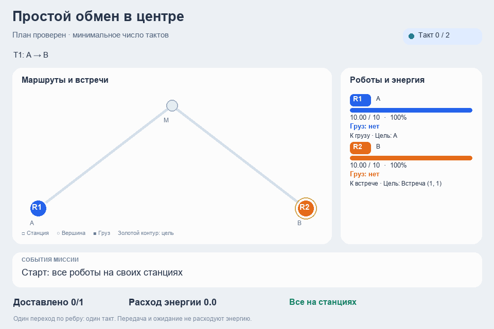
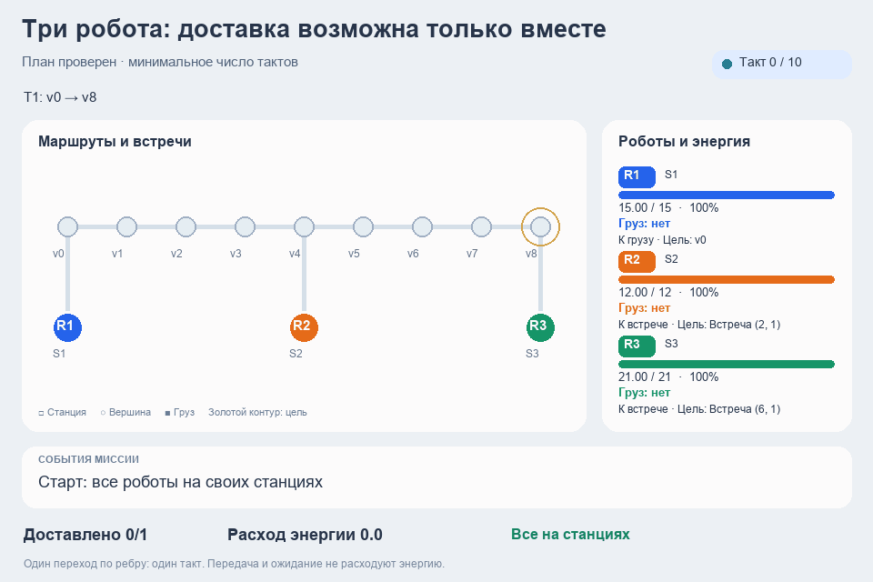
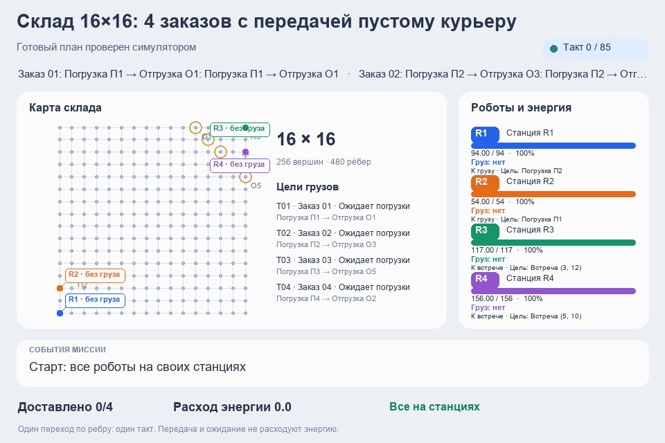
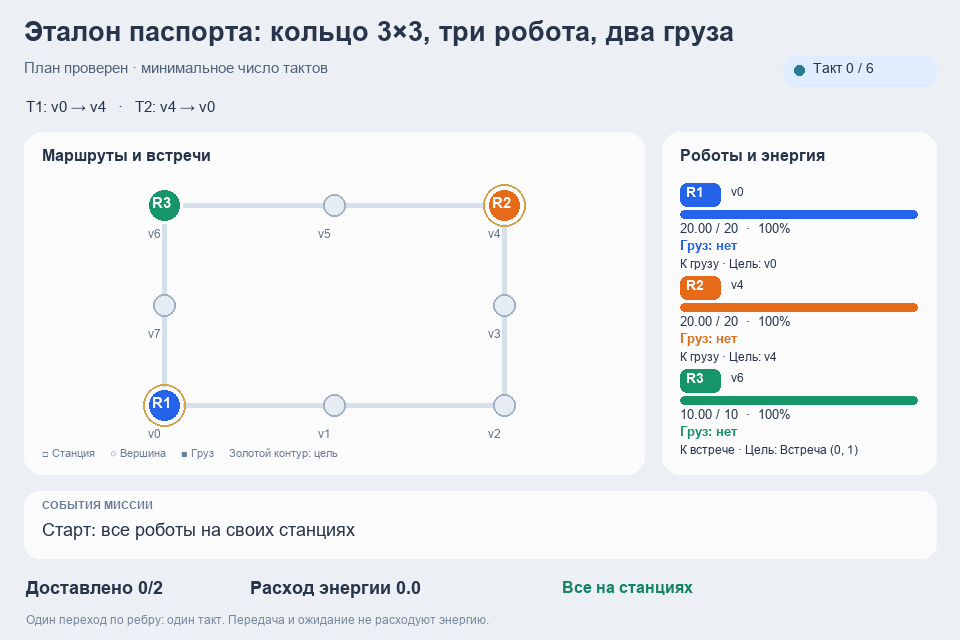
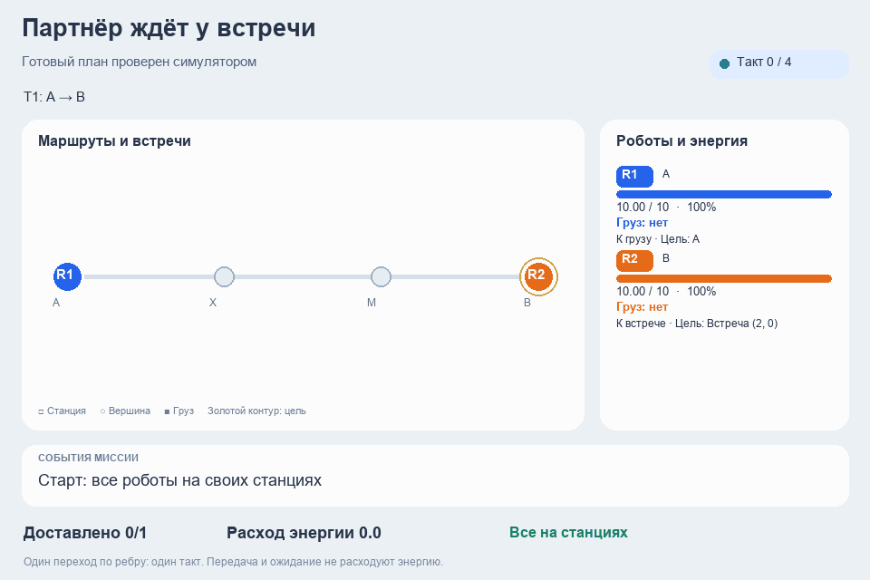
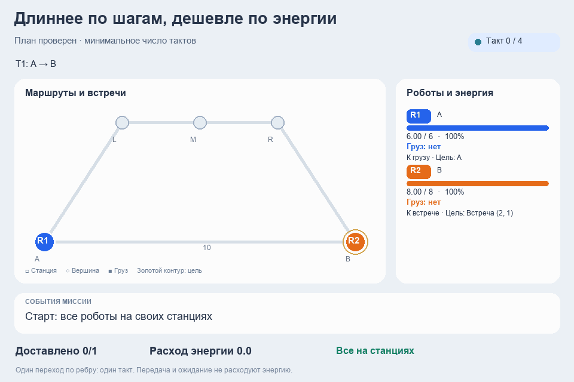
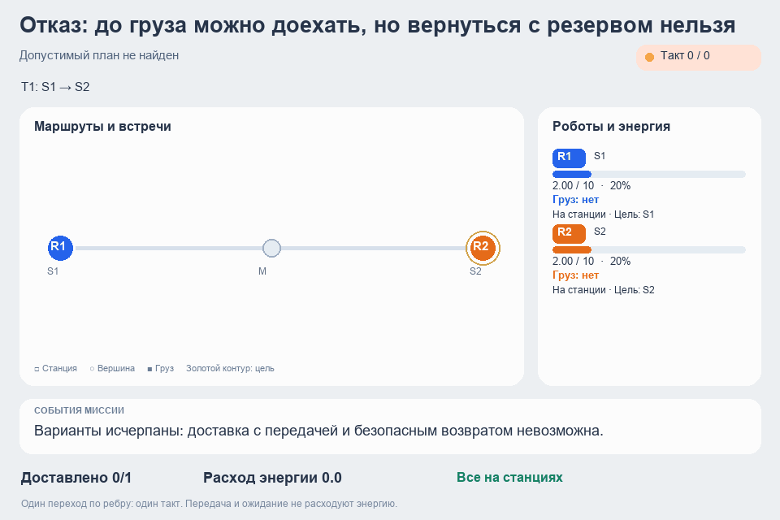

# Примеры работы роботов

Откройте [видеогалерею](index.html) или скачайте [все примеры одним архивом](demos.zip).

## Склад 16×16: 25 заказов с передачей пустому курьеру

25 разных доставок между пятью точками погрузки и пятью точками отгрузки. Четыре робота передают грузы свободным напарникам в разных частях склада. Следующее задание начинается из текущей позиции. Подзарядок нет; без передач энергии хватит максимум на 24 доставки.

[Видео MP4](grid16_team4_25.mp4) · [Отчёт симулятора](grid16_team4_25.json)

## Простой обмен в центре

Два робота встречаются в центре. Первый передаёт груз второму, после доставки оба возвращаются на свои станции.

[Видео MP4](simple_handoff.mp4) · [Отчёт симулятора](simple_handoff.json)

## Три робота: доставка возможна только вместе

Одного робота недостаточно: груз проходит через всю команду. Три робота выполняют свои участки и возвращаются с запасом энергии.

[Видео MP4](energy_relay.mp4) · [Отчёт симулятора](energy_relay.json)

## Склад 16×16: 4 заказов с передачей пустому курьеру

Склад 16×16, четыре робота и четыре доставки. Сборщики передают грузы свободным курьерам, затем берут следующее задание из текущей позиции. Все возвращаются на станции с резервом.

[Видео MP4](grid16_team4.mp4) · [Отчёт симулятора](grid16_team4.json)

## Эталон паспорта: кольцо 3×3, три робота, два груза

Два груза нужно доставить в противоположные углы. Роботы встречаются на кольце и по очереди передают грузы свободному напарнику.

[Видео MP4](passport_ring.mp4) · [Отчёт симулятора](passport_ring.json)

## Партнёр ждёт у встречи

Один робот прибывает раньше и ждёт свободного напарника в точке встречи. После передачи роботы продолжают доставки.

[Видео MP4](waiting_partner.mp4) · [Отчёт симулятора](waiting_partner.json)

## Длиннее по шагам, дешевле по энергии

Прямое ребро слишком дорого по энергии. Роботы выбирают более длинный экономный маршрут и передают груз на встрече.

[Видео MP4](energy_detour.mp4) · [Отчёт симулятора](energy_detour.json)

## Отказ: до груза можно доехать, но вернуться с резервом нельзя

Энергии на движение хватает, но на безопасное возвращение уже нет. Команда отказывается от задания и остаётся на станциях.

[Видео MP4](insufficient_energy.mp4) · [Отчёт симулятора](insufficient_energy.json)
