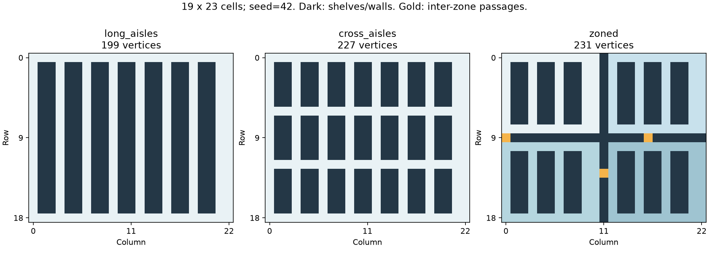

# Параметрические склады и проверка планировщиков

Добавлены три семейства карт: `long_aisles`, `cross_aisles`, `zoned`.
Вершинами графа служат только проходимые клетки, стеллажи и стены исключены.
Геометрия ниже построена генератором для сетки 19×23, seed 42.



Правила проекта сохранены: переход по ребру занимает один такт и одну единицу
заряда, ожидание бесплатно, в вершине помещаются два робота. Передача происходит
при встрече. Все роботы могут проходить между зонами.
Алгоритмы назначения Greedy и CP-SAT сохранены. В маршрутизации исправлен учёт
ожидания принимающего робота: оно включено в A*, поэтому ограничения CBS действуют
и до момента передачи. Исправление покрыто отдельным регрессионным тестом.

## Проверки

Проверены 89 тестов и матрица из 24 запусков: три топологии, два seed, две нагрузки,
два планировщика. Все 24 плана прошли физическую проверку и доставили все грузы.
Дополнительно проверены два плана на большом складе. Независимый аудит повторно
проверил геометрию, SHA256 входов, все доставки и метрики 26 планов на 13 входах.

В каждой паре используется один сохранённый экземпляр, оба планировщика получают
свежие состояния. Полные входы, планы, параметры и отчёты доступны в
[архиве доказательств](warehouse-evidence-20261029.zip), сводные данные и SHA256
файлов в [JSON-отчёте](warehouse-results-20261029.json).

## Метрики

Последняя доставка определяется по фактическому перемещению грузов, в тактах.
Используемость равна средней доле роботов, которые движутся или ждут с грузом,
на интервале от первого такта до последней доставки. Пустое ожидание занятостью
не считается. Время расчёта включает назначения и маршрутизацию, без визуализации
и проверки; измерено в секундах.

Средняя нагрузка, seed 42: сетка 16×20, четыре робота, восемь заданий, заряд 2000,
горизонт 2048, общий лимит решателя 6 секунд.

| Карта | Планировщик | Последняя доставка | Используемость | Время расчёта, с |
|---|---|---:|---:|---:|
| long_aisles | Greedy | 92 | 63,32% | 0,006 |
| long_aisles | CP-SAT | 56 | 94,64% | 0,154 |
| cross_aisles | Greedy | 67 | 64,18% | 0,007 |
| cross_aisles | CP-SAT | 29 | 92,24% | 0,116 |
| zoned | Greedy | 139 | 61,15% | 0,011 |
| zoned | CP-SAT | 66 | 92,42% | 0,122 |

Большой склад `long_aisles`: площадка 128×128 клеток, 5800 проходимых вершин,
5968 рёбер, 12 роботов, 64 задания, заряд 5000. Горизонт 16384, лимит 60 секунд,
seed геометрии и размещения 42, seed Greedy 0. В каждой строке подтверждены
64/64 доставки, вместимость, заряд и физическая непрерывность грузов.

| Планировщик | Последняя доставка | Используемость | Время расчёта, с | Передачи |
|---|---:|---:|---:|---:|
| Greedy | 2293 | 61,57% | 9,08 | 23 |
| CP-SAT | 984 | 98,60% | 43,48 | 0 |

Это отдельные запуски, оценки оптимальности общего плана не получены.
CP-SAT решает сокращённую модель; его objective и best bound сохранены отдельно
от фактических метрик. Статус общего допустимого плана указан как `FEASIBLE`.
Геометрия и размещение воспроизводятся по конфигурации и seed; многопоточный
CP-SAT при повторном поиске может найти другой допустимый план.

## Повторение

После установки зависимостей из `requirements.txt` одна команда создаёт все
три типа карт и выполняет матрицу из 24 запусков:

```powershell
.\.venv\Scripts\python.exe benchmark.py --matrix
```

Большой парный эксперимент:

```powershell
.\.venv\Scripts\python.exe benchmark.py --n 128 --m 128 --tasks 64 --robots 12 --battery 5000 --horizon 16384 --topologies long_aisles --seeds 42 --time-limit 60
```

Чтобы использовать ровно сохранённый вход из опубликованного эксперимента:

```powershell
Expand-Archive docs/warehouse-evidence-20261029.zip -DestinationPath runs/warehouse-evidence
.\.venv\Scripts\python.exe benchmark.py --instance runs/warehouse-evidence/large/input.json --horizon 16384 --time-limit 60
```

Результаты попадают в новую папку `runs/warehouse_*`: JSON-планы, проверенные
метрики, CSV и HTML-пульт. Результаты не перезаписываются. Ненулевой код завершения
означает, что хотя бы один запуск не дал подтверждённого плана; его статус и
пустые метрики сохраняются в отчёте. `TIMEOUT` и `UNKNOWN` не доказывают
неразрешимость задания.
